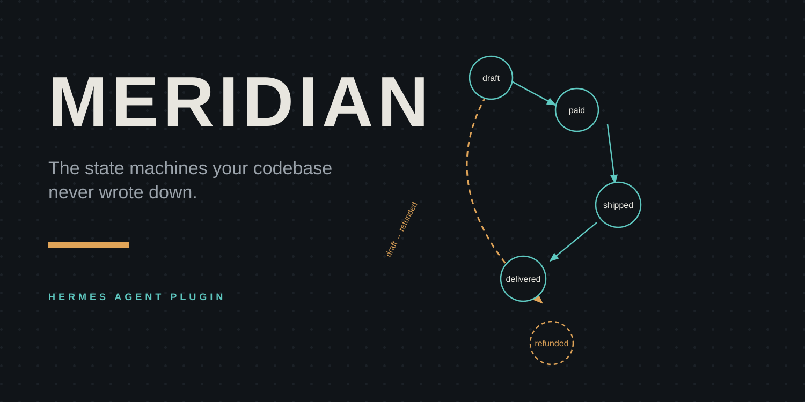

# Meridian



**Find the state machines your codebase never wrote down — and prove every one of them.**

Every `status`, `state`, `phase`, `stage`, `step` and `disposition` field in your
repo is a state machine that nobody documented, nobody reviewed, and nobody
tested. It is also where *"impossible"* bugs live — the refund that fires before
any money moved, the `warehouse_hold` that exists in the enum but no code path
can ever reach, the "support override" that closes a ticket from anywhere.

Meridian is a Hermes Agent plugin that finds those implicit machines, anchors
every state and transition to real source (`file:line`), and enforces the
transitions you accept — in the agent, in your terminal, and in CI.

> Let the AI propose. Let deterministic code decide. Keep a log nobody can quietly edit.

## What it does

```
meridian_scan        → discover machines: states, initial states, transitions (file:line),
                       unreachable states, dead states, unguarded writes
meridian_verify      → edge-level verdicts; spec violations with anchors
meridian_diagram     → Mermaid stateDiagram-v2 or XState v5 JSON (code-accurate)
meridian_spec        → draft / accept / show / check the .meridian.yaml spec (CI primitive)
meridian_ledger      → SHA-256 hash-chained, append-only evidence ledger of every verdict
meridian_report      → self-contained Markdown report with the ledger head
```

Plus `/meridian` in-session, `hermes meridian <scan|verify|check|report|diagram|spec|ledger>`
from the shell, an auto-verify hook that re-checks state-machine files right after
the agent edits them, and a bundled `meridian:audit` skill.

**Zero dependencies. Zero network calls. No model calls. Zero configuration.**
Python sources are analyzed with a real AST pass; TypeScript/JavaScript with a
lexical pass (findings marked low/medium confidence). A plugin that fails its
own checks fails *loudly*, not silently.

## In one sitting — what it catches

Given an ordinary, deliberately buggy order pipeline (`examples/demo-order-pipeline/`):

```
files_scanned: 1    machines: 4 (Order.status, Order.payment_status, enum:*)
Order.status
  unreachable: unverified_shipping, warehouse_hold
  dead:        unverified_shipping, warehouse_hold
  VIOLATION    orders.py:62   unverified_shipping -> shipped   [not-allowed]
  VIOLATION    orders.py:78   draft -> refunded                [deny: money never moved]
  warning      orders.py:84   unguarded write via force_close()
```

`hermes meridian check` exits `1`. Fix the two lines, re-run, exit `0`.

## Install & use

```bash
# as a Hermes plugin (catalog or local directory)
hermes plugins install meridian                      # once listed
hermes plugins enable meridian

# or from a checkout
hermes plugins install ./meridian --enable
hermes plugins doctor ./meridian --ci
hermes plugins validate ./meridian --install-deps
```

In a session:

```
You: find the state machines in this repo            → meridian_scan
You: why can orders get refunded before they ship?   → meridian_verify
You: accept the spec (we reviewed it)                → meridian_spec accept
```

From your shell / CI (fail the build on new violations):

```bash
hermes meridian scan .            # table of machines
hermes meridian check --strict    # exit 1 on violations
hermes meridian report --out .meridian/report.md
hermes meridian ledger verify     # re-verify the evidence chain
```

```yaml
# CI sketch — install Hermes the way your runner needs it, then enforce the spec
- uses: actions/checkout@v4
- name: Install Hermes
  run: curl -fsSL https://hermes-agent.nousresearch.com/install.sh | bash
- name: Verify state machines
  run: hermes meridian check --strict --root .
```

## How it works — the three layers

1. **Discover (deterministic).** AST-based extraction for Python: enums with
   state-like names become exact alphabets; state-like fields
   (`status|state|phase|stage|step|disposition|lifecycle|mode|workflow|fulfillment`)
   become machines; writes inside `if`/`elif`/`while` branches are attributed to
   exactly those branches — never to a made-up source. Initial states come from
   constructors and class-level defaults. Dead states (never assigned),
   unreachable states (no path from initial), and unguarded writes are
   first-class findings.
2. **Verify (deterministic, spec-gated).** `.meridian.yaml` is the enforcement
   input: an `allow`/`deny` edge list per machine, drafted from observed anchored
   transitions, reviewed by a human or the agent, accepted explicitly. Then
   `check` is exact: any anchored edge denied or not in `allow` is a violation
   with a `file:line` anchor; unguarded writes are warnings (violations with
   `--strict`); `deny` always wins over `allow`.
3. **Audit (hash-chained).** Every scan, verdict, spec acceptance and check is
   an entry in `$HERMES_HOME/plugin-data/meridian/ledger.jsonl`, each entry
   committing to the previous entry's SHA-256. `meridian_ledger verify`
   recomputes the chain; appending to a broken chain is refused. The ledger
   stores machine ids, verdict counts and anchors — never file contents.

### Where the AI fits

Hermes's model calls the Meridian tools; it proposes — the machine
names, the spec draft, the fix you apply next. Meridian decides — nothing it
reports is model-asserted, and nothing enters the spec without passing the
acceptance gate. If no model is in play (CI, cron), everything still works:
the analyzer is pure deterministic code.

## What Meridian does not do

- It cannot know domain legality. It enforces the spec you accept; review the draft.
- JS/TS evidence is lexical and labeled by confidence — the Python AST pass is the authoritative path today; deeper JS analysis is on the roadmap.
- Unguarded writes are suspicions, not guilty verdicts.
- Nested function scopes fold into their parent (documented limitation).

## Develop & test

```bash
python3 -m unittest discover -s tests -v   # 15 tests, stdlib only
```

The plugin is a single directory: `plugin.yaml` + `__init__.py` + `analyzer/`
+ `schemas.py` + `tools.py` + a bundled `skills/audit/SKILL.md`.

## License

MIT — see [LICENSE](LICENSE).
